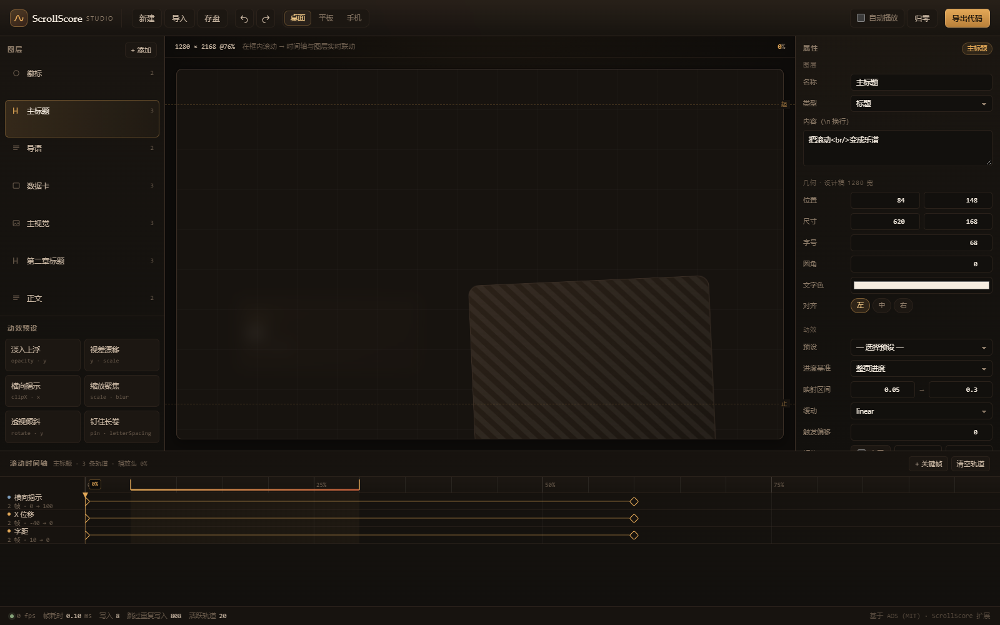

# ScrollScore Studio

**把「滚动触发」改造成「滚动编排」。**

上游 [AOS (Animate On Scroll)](https://github.com/michalsnik/aos) 是一个二值触发器：元素进入视口就加上 `aos-animate` class，离开就移除。本项目在它的源码上做二次开发，新增一层**以滚动进度为时间轴的连续插值引擎**，并在此之上做出一个可视化编排工作台 —— 拖关键帧、看实时预览、导出可直接上线的代码。

> 上游：`michalsnik/aos` · MIT · ★28k · 本仓库保留其全部提交历史（259 commits）
> 新增：`src/js/scrub/`（引擎）+ `src/sass/_scrub.scss`（样式）+ `studio/`（工作台）
> 上游原始 README 保留在 [`README.upstream.md`](README.upstream.md)，未改动。



---

## 1. 为什么不是「换个皮」

上游的能力边界（已用 `grep` 逐一验证，命中数为 0）：

| 关键词 | 上游 `src/` 命中 |
|---|---|
| `scrub` | 0 |
| `keyframe` | 0 |
| `timeline` | 0 |
| `progress` | 0 |
| `lerp` / `interpolat` | 0 |
| `pin` | 0 |
| `reduced-motion` | 0 |

上游只有 `handleScroll()` 里的 `top >= position.in` 二值判断。本项目新增的是**语义层**，不是样式层：

1. **连续进度引擎** —— 元素或整页的滚动进度映射为 `0..1`，逐帧插值，而不是切换 class。
2. **多属性关键帧轨道** —— 每条轨道是 `[{p, v, ease}]`，`p` 是滚动进度而非秒数；同一图层可有任意多条轨道（位移/缩放/旋转/透明度/模糊/揭示/字距/圆角）。
3. **pin（钉住）** —— 声明式区间窗口，配合 sticky 容器做长卷章节。
4. **可回溯的编排轴** —— 改窗口高度、换断点，节奏不变；这是「进度轴」相对「时间轴」的核心优势。
5. **三种导出目标** —— 纯 CSS（`animation-timeline: scroll()`）、自包含 JS runtime、单文件 HTML，全部由同一份工程数据生成。
6. **性能可观测** —— 引擎内置帧耗时、写入数、跳过数、活跃轨道数；状态栏实时显示。
7. **`prefers-reduced-motion` 降级** —— 引擎直接跳到终态关键帧，CSS 导出也生成对应的 `@media` 包裹。

## 2. 工作台能力

| 区域 | 能力 |
|---|---|
| 图层列表 | 增删、选中、重命名、类型切换（标题/正文/面板/图像/徽标）、轨道数概览 |
| 滚动舞台 | 真实滚动容器，实时 scrub；断点切换（1280 / 834 / 390）；起止参考线 |
| 属性面板 | 几何、字号、圆角、颜色、对齐、映射区间、缓动、触发偏移、pin 开关、轨道增删 |
| 滚动时间轴 | 横轴 = 滚动进度（0–100%）；关键帧菱形可拖拽；双击轨道插入；`Alt+点击` / 右键删除；区间把手可拖 |
| 动效预设 | 淡入上浮 / 视差漂移 / 横向揭示 / 缩放聚焦 / 透视倾斜 / 钉住长卷 |
| 导出 | 纯 CSS · JS runtime · 工程 JSON · 独立 HTML，一键复制或下载 |
| 历史 | 撤销/重做（Ctrl+Z / Ctrl+Shift+Z），一次拖拽 = 一条历史 |
| 状态栏 | fps、帧耗时、写入数、跳过重复写入数、活跃轨道数 |

## 3. 快速开始

```bash
cd studio
npm install
npm run dev          # http://localhost:4180
```

构建与预览：

```bash
npm run build
npm run preview      # 生产产物，e2e 测试跑在这个模式上
```

部署到子路径（GitHub Pages 等）：

```bash
BASE_PATH=/scrollscore-studio/ npm run build
```

> Windows Git Bash 下 `BASE_PATH=/x/` 会被路径转换，需要 `MSYS_NO_PATHCONV=1` 前缀。

## 4. 在真实页面里使用

### 4.1 零 JavaScript（声明式）

```html
<section
  data-aos-scrub
  data-aos-mode="page"
  data-aos-range="0.2,0.8"
  data-aos-ease="ease-out-cubic"
  data-aos-track="opacity:0>1;y:120>0;scale:0.94>1">
  内容
</section>
```

```js
import AOS from 'aos';
AOS.init({ scrub: true });
```

### 4.2 选择器配置式

```js
AOS.scrub({
  entries: [
    {
      target: '#hero',
      mode: 'page',
      range: [0, 0.5],
      ease: 'ease-out-quart',
      tracks: {
        y: [{ p: 0, v: 80 }, { p: 1, v: 0, ease: 'ease-out-quart' }],
        opacity: [{ p: 0, v: 0 }, { p: 0.6, v: 1 }]
      }
    }
  ]
});
```

### 4.3 上游行为完全不变

不传 `scrub` 选项、不使用 `data-aos-scrub` 时，`data-aos` 的 class 切换逻辑与上游一致。`tests/e2e/upstream.spec.js` 有 9 个用例专门守这条线。

### 4.4 Pin 章节

导出的 JS runtime 不会自动插入 sticky 容器（那会改变文档结构）。手工配方：

```html
<div class="aos-pin" style="height: calc(100vh + 600px)">
  <div class="aos-pin__viewport">
    <div class="aos-pin__content" data-ss="ly-xxx">章节内容</div>
  </div>
</div>
```

`600px` = `(pinEnd - pinStart) × 可滚动距离`。`src/sass/_scrub.scss` 已包含 `.aos-pin*` 三件套。

## 5. 测试与实测数据

### 5.1 测试规模

| 套件 | 数量 | 覆盖 |
|---|---|---|
| 单元（Vitest + jsdom） | **116** | 缓动求解、关键帧求值、进度映射、schema 往返、三个导出器、引擎注册/写入/差分/reduced-motion/pin |
| e2e（Playwright） | **26** | 上游兼容 9 项、工作台交互 13 项、导出产物独立运行、响应式、性能 |
| 视觉验收（自建） | 11 张全页截图 + 8 张图层级截图 | 像素覆盖率、调色板、动态范围、对比度、DOM 几何 |

```bash
npm test           # 116 passed
npm run test:e2e   # 26 passed
npm run verify     # 全页截图 + 像素统计 + 交互断言
npm run audit      # 图层级审计 + WCAG 对比度
```

### 5.2 性能（真实测量，未修饰）

环境：headless Chromium（系统 Edge），1600×1000，软件渲染，`--force-device-scale-factor=1`，Windows 11。

**240 帧滚动 sweep，8 图层 / 20 条轨道：**

| 指标 | 引擎 | 基线（手写 style，无引擎） |
|---|---|---|
| 帧间隔 p50 | 7.0 ms | 7.0 ms |
| 帧间隔 p95 | 7.8 – 20.7 ms（多次运行波动） | 7.3 ms |
| 帧间隔 p99 | 21.1 – 48.9 ms | 7.6 ms |
| 最大帧间隔 | 27.9 – 111.5 ms | 22.1 ms |
| 单次 tick 平均 | **0.49 ms** | — |
| 单次 tick 最大 | 2.6 ms | — |
| 隔离 tick（无 layout/paint）p50 / p95 | **0.10 / 0.80 ms** | — |
| 写入 / 跳过重复写入 | 331 / 3501 | — |

**怎么读这组数字：**

- **单帧计算成本 0.49 ms** 是引擎自身的开销，占 16.7 ms 预算的 3%。隔离测量（不触发布局与绘制）的 p50 是 0.10 ms，说明求值本身极轻。
- **帧间隔 p99 的尖峰（21–49 ms）不是引擎造成的**：同一进程里基线也出现过 22 ms，且尖峰位置随机，符合 GC 与软件光栅化的特征。headless 的帧间隔不代表真实刷新率，这里只用于横向对比。
- **引擎比基线慢 1–3 ms/帧是预期内的**：基线每层只写 2 个属性，引擎要算 20 条轨道 × 8 图层。代价换来的是任意关键帧、任意缓动、差分跳过无效写入。
- **跳过 3501 次写入**：差分生效。滚动停下后引擎仍在跑 rAF，但不再产生 DOM 写入。

> 这些数字全部来自 `studio/tests/e2e/.perf.json` 与 `docs/shots/verify-report.json`，可用 `npm run test:e2e` 复现。**没有做任何修饰或取最好值。**

### 5.3 视觉验收（像素级，不靠肉眼判断）

11 张全页截图，非背景像素占比 **17.2%–24.9%**，调色板 **234–310** 色，暖色像素占比 1.65%，冷色像素 0（除导出弹窗外全为 0）。

8 个图层逐层截图审计：

```
badge    徽标      box 123.9x22.5   palette 35  range 183.2
heading  主标题     box 470.8x127.6  palette 62  range 218.5
text     导语      box 356.9x72.9   palette 35  range 164.8
panel    数据卡     box 356.9x141.2  palette 63  range 218.5
image    主视觉     box 366.4x272.7  palette 11  range  56.3
heading  第二章标题   box 425.3x127.6  palette 40  range 218.5
text     正文      box 356.9x72.9   palette 33  range 164.8
panel    收尾卡     box 779.1x159.5  palette 58  range 218.5
```

对比度（相对舞台底色 `#17130f`）：正文 9.39:1，标题 15.94:1，徽标 11.86:1 —— 全部高于 WCAG AA 的 4.5:1。

`range` 是图层内部的亮度动态范围：纯色块为 0，有文字/边框/渐变的图层在 56–219 之间。它用来证明「这个图层真的渲染出了内容」，而不是一个不可见的空盒子。

## 6. 目录结构

```
scrollscore-studio/
├── src/                        # 上游 AOS 源码（保留提交历史）
│   ├── js/aos.js               # 改动：接入 scrub 引擎（opt-in）
│   ├── js/scrub/               # 新增：连续进度引擎
│   │   ├── easing.js           #   cubic-bezier 数值求解 + 采样表
│   │   ├── keyframes.js        #   轨道模型、求值、CSS 合成
│   │   ├── progress.js         #   element / page 两种进度映射、pin 相位
│   │   ├── engine.js           #   rAF 调度、读写分离、差分写入、遥测
│   │   ├── schema.js           #   工程文档校验与归一化
│   │   ├── attributes.js       #   data-aos-* 声明式解析
│   │   └── index.js            #   公共出口
│   ├── js/helpers/ libs/       # 上游，未改动
│   └── sass/                   # 上游 + 新增 _scrub.scss
├── studio/                     # 新增：可视化工作台（Vite）
│   ├── index.html              #   工作台
│   ├── upstream.html           #   上游兼容性测试夹具页
│   ├── src/core/               #   store（含撤销重做）、exporters
│   ├── src/ui/                 #   stage / timeline / inspector / layers / exportDialog
│   ├── src/styles/             #   tokens / app / timeline
│   ├── src/preview/content.js  #   默认示例工程
│   ├── tests/unit/             #   116 个单元测试
│   ├── tests/e2e/              #   26 个 e2e + 性能
│   └── scripts/                #   verify / visual-audit / probe
├── cypress/ demo/              # 上游，未改动（见 §7）
├── docs/shots/                 # 验收截图 + 报告 JSON
├── NOTICE                      # 署名与新增内容声明
└── UPSTREAM.md                 # 上游改动清单 + 发现的上游缺陷
```

## 7. 已知限制

1. **CSS 目标无法表达 pin**。`animation-timeline` 没有 sticky 语义，导出时会给出明确警告；需要钉住请用 JS runtime。
2. **CSS 目标的缓动精度受限**。CSS 每个关键帧只能挂一条 `animation-timing-function`，作用于到下一帧的区间；引擎模型允许逐段独立缓动，导出时以「到达该帧的缓动」为准，极端多段配置可能与预览有细微差异。
3. **`element` 模式在工作室预览里按文档内偏移计算**，与真实页面的视口相对计算略有差异；工作室的默认与推荐轴是 `page`。
4. **`clipX` 目前只做左侧揭示**（`inset(0 X% 0 0)`），未提供四向。
5. **上游 `cypress/` 套件未运行**。上游锁定 `cypress@2` + `node-sass@4` + `rollup@0.58`，在 Node 22 上无法安装。等价断言已移植到 `tests/e2e/upstream.spec.js`（9 项），覆盖 `data-aos` 的 init/animate、body 全局属性、二值路径不写内联 transform、`refresh`/`refreshHard` 可调用。

## 8. 上游缺陷记录

二次开发过程中在上游源码里发现两处问题，**没有静默修改**，而是记录在 `UPSTREAM.md`，并在新引擎里用独立的 `TRUE_PRESETS` 表提供正确曲线，`AOS_PRESETS` 保持上游原值以确保 `data-aos-easing` 行为不变：

1. `src/sass/_easing.scss` 里 `linear` 是 `cubic-bezier(.25,.25,.75,.75)`，并非线性。
2. `ease-in-cubic` / `ease-out-cubic` / `ease-in-out-cubic` 与 `ease-in-quad` / `ease-out-quad` / `ease-in-out-quad` 数值完全相同（复制粘贴遗留）；`ease-*-quart` 同样与 quad 重复。

`tests/unit/easing.test.js` 有专门的用例锁住这个差异，防止有人「顺手修好」而改变上游行为。

## 9. 许可与署名

- 上游代码：MIT © 2015 Michał Sajnóg，`LICENSE` 文件保持原文未改。
- 新增代码与工作台：MIT，见 `NOTICE`。
- 本项目不是上游官方分支，与上游维护者无隶属关系。

---

## English summary

**ScrollScore Studio** turns AOS from a binary "add class when in view" trigger into a continuous, progress-driven motion choreographer.

- **New engine** (`src/js/scrub/`): keyframe tracks keyed on scroll progress (not time), cubic-bezier solver with a corrected preset table, pin windows, reduced-motion fallback, diffed style writes, and built-in frame telemetry.
- **New studio** (`studio/`): layer list, live scroll stage, property sheet, and a timeline whose horizontal axis is scroll progress. Drag keyframes, apply presets, undo/redo, export.
- **Four export targets** from one document: CSS `animation-timeline`, self-contained JS runtime, project JSON, single-file HTML.
- **Tests**: 116 unit + 26 e2e (9 of which lock the untouched upstream contract) + a pixel-level visual audit.
- **Measured**: 0.49 ms per tick over 8 layers × 20 tracks; isolated evaluation p95 0.80 ms. Numbers are reported verbatim, including the headless p99 spikes we cannot attribute to the engine.

MIT. Upstream © Michał Sajnóg. Not an official fork.
